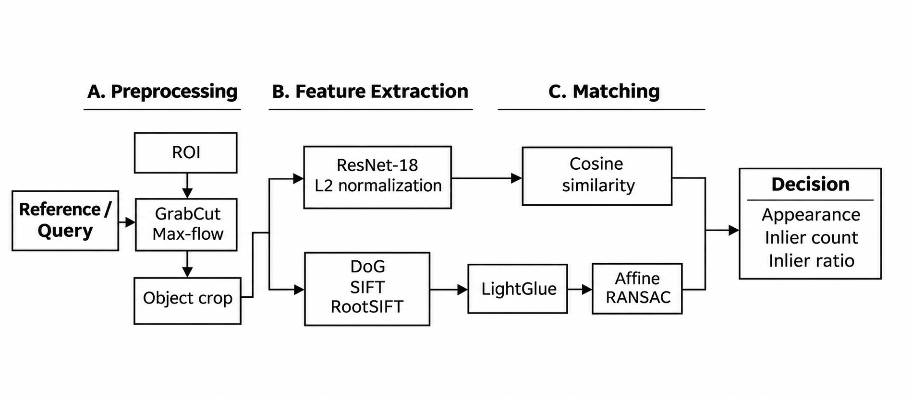

# ObjectKEY

## Project overview

ObjectKEY compares whether two photographs show the **same physical object from a similar view**. Users select the object in each image, extract a reference template and compare a query image. The Windows GUI supports mouse-drawn ROIs, foreground-mask correction and optional template saving.

The pipeline combines pretrained ResNet-18 and LightGlue with directly implemented image processing, DoG/SIFT, RootSIFT, GrabCut, maximum flow and affine RANSAC.

## How it works



### A. Image preprocessing

A user-selected ROI identifies the object. GrabCut separates its foreground from the background, and a foreground-centered crop feeds both feature branches. ResNet uses an aligned image with a neutral background; SIFT uses the original crop with foreground-centered keypoint selection.

| Technology | Details |
| --- | --- |
| ROI, resizing and principal-axis alignment | [Image preprocessing](docs/preprocessing.md) |
| Foreground/background color models and graph cuts | [GrabCut](docs/grabcut.md) |
| FIFO push-relabel and residual minimum cut | [Maximum flow](docs/max-flow.md) |

### B. Feature extraction

ResNet-18 produces a normalized global appearance vector. DoG detects local keypoints, SIFT describes their gradient patterns, and RootSIFT prepares the descriptors for matching.

| Technology | Details |
| --- | --- |
| Pretrained residual features and embedding pooling | [ResNet-18](docs/resnet18.md) |
| Separable convolution and scale-space smoothing | [Gaussian filtering](docs/gaussian-filtering.md) |
| Scale-space extrema and subpixel localization | [DoG keypoints](docs/dog-keypoints.md) |
| Orientation assignment and gradient histograms | [SIFT descriptors](docs/sift.md) |
| Histogram normalization and square-root embedding | [RootSIFT](docs/rootsift.md) |

### C. Image matching

Cosine similarity compares global appearance. LightGlue finds local correspondences, and affine RANSAC checks how many agree with a common transformation.

| Technology | Details |
| --- | --- |
| Normalized-vector dot product and final decision | [Cosine similarity](docs/cosine-similarity.md) |
| Attention-based local correspondences | [LightGlue](docs/lightglue.md) |
| Affine model and Householder QR least squares | [Affine fitting](docs/affine-transform.md) |
| Robust estimation, inliers and model refinement | [RANSAC](docs/ransac.md) |

The final decision combines appearance similarity $s$, inlier count $n$ and inlier ratio $r$:

$$
\mathrm{Accept}=(s\ge\tau_s)\land(n\ge\tau_n)\land(r\ge\tau_r).
$$

Each $\tau$ is the corresponding configurable threshold. [config/matching.ini](config/matching.ini) also defines the residual tolerance used to classify RANSAC inliers.

## Run and datasets

### Build and launch

Install Visual Studio with **Desktop development with C++**, the MSVC toolset listed in the [Appendix](#appendix), a Windows SDK and Python for model export. From the repository root:

```powershell
powershell -ExecutionPolicy Bypass -File setup.ps1
```

Setup downloads ONNX Runtime and pretrained weights, prepares the Python environment and exports the models. Open `ObjectKEY.slnx`, select **x64 / Release**, and build.

```powershell
.\bin\x64\Release\ObjectKEY.exe --gui
```

The prepared application uses C++ and ONNX Runtime; Python is needed only for model export. Dependency and model licenses are listed in [THIRD_PARTY.md](THIRD_PARTY.md).

### GUI usage

1. **Load Image** under Reference, drag an object ROI and click **Extract**.
2. **Load Image** under Query, select its ROI and click **Compare**.
3. Optionally **Save** the reference template or restore it with **Load Template**. Saving is not required for comparison.
4. Use **Edit Mask** to paint foreground/background corrections and refine GrabCut, or **Load Mask** to supply a full-image binary mask.
5. Edit `config/matching.ini` and click **Reload Settings** to update thresholds. The GUI displays the current settings.

<details>
<summary>CLI examples and configuration</summary>

Run from the repository root after downloading COIL-100:

```powershell
.\bin\x64\Release\ObjectKEY.exe compare --reference data/coil-100/obj1__0.png --reference-roi full --query data/coil-100/obj1__5.png --query-roi full
.\bin\x64\Release\ObjectKEY.exe enroll --image data/coil-100/obj1__0.png --roi full --out data/coil-object1.okt
.\bin\x64\Release\ObjectKEY.exe verify --image data/coil-100/obj1__5.png --roi full --template data/coil-object1.okt
```

For your own images, replace the paths and use an enclosing ROI in `x,y,width,height` format. Use `--help` for all options.

| Configuration key | Purpose |
| --- | --- |
| `appearance_threshold` | Minimum ResNet cosine similarity |
| `minimum_inliers` | Minimum number of affine-consistent matches |
| `minimum_inlier_ratio` | Minimum fraction of matches that are inliers |
| `ransac_reprojection_ratio` | Residual tolerance relative to the query foreground diagonal |

All keys are required. The CLI also accepts `--config PATH` and an appearance-only `--threshold VALUE` override.

</details>

### Datasets

| Dataset | Purpose | Source |
| --- | --- | --- |
| COIL-100 | Controlled object/view comparisons | [Columbia CAVE](https://www.cs.columbia.edu/CAVE/software/softlib/coil-100.php) |
| iLab-6pose | Same object and pose under different backgrounds | [Official GSL repository](https://github.com/gyhandy/Group-Supervised-Learning#datasets) |
| YCB-Video / BOP | Real scenes with masks and pose annotations | [BOP](https://bop.felk.cvut.cz/datasets/) / [Archive list](https://huggingface.co/datasets/bop-benchmark/ycbv/tree/main) |
| Your photographs | Reference/query comparisons in the GUI or CLI | Open local image files directly |

Datasets are optional and are not downloaded by setup. ImageNet is the ResNet pretraining source; its images are not required to run ObjectKEY.

<details>
<summary>Download and extract evaluation datasets</summary>

Run the following commands from the repository root after setup. Download only the datasets you need.

**COIL-100** — approximately 131 MB. Extracts to `data/coil-100/`.

```powershell
New-Item -ItemType Directory -Force data | Out-Null
curl.exe --fail --location --retry 3 "https://www.cs.columbia.edu/CAVE/databases/SLAM_coil-20_coil-100/coil-100/coil-100.zip" --output data/coil-100.zip
.\.venv\Scripts\python.exe -m zipfile -e data/coil-100.zip data
```

Filenames encode object identity and turntable angle, for example `obj1__0.png` and `obj1__5.png`.

**iLab-6pose** — approximately 6.96 GB, plus extraction space.

```powershell
New-Item -ItemType Directory -Force data/ilab-6pose | Out-Null
curl.exe --fail --location --retry 3 "https://ilab.usc.edu/datasets/iLab_6pose.zip" --output data/ilab-6pose/iLab_6pose.zip
.\.venv\Scripts\python.exe -m zipfile -e data/ilab-6pose/iLab_6pose.zip data/ilab-6pose
```

Images appear beneath `train_img_c00_10class/` and pose subdirectories. To test a background change, hold object identity, camera, pose, lighting and focus constant while varying the background token. Pose tokens are categorical, not calibrated camera angles.

**YCB-Video / BOP test subset** — approximately 660 MB, plus extraction space.

```powershell
New-Item -ItemType Directory -Force data/ycbv-background | Out-Null
curl.exe --fail --location --retry 3 "https://huggingface.co/datasets/bop-benchmark/ycbv/resolve/main/ycbv_base.zip" --output data/ycbv-background/ycbv_base.zip
curl.exe --fail --location --retry 3 "https://huggingface.co/datasets/bop-benchmark/ycbv/resolve/main/ycbv_test_bop19.zip" --output data/ycbv-background/ycbv_test_bop19.zip
.\.venv\Scripts\python.exe -m zipfile -e data/ycbv-background/ycbv_base.zip data/ycbv-background
.\.venv\Scripts\python.exe -m zipfile -e data/ycbv-background/ycbv_test_bop19.zip data/ycbv-background
```

Base metadata appears under `data/ycbv-background/ycbv/`; frames and annotations appear under `data/ycbv-background/test/<scene>/`. Pair each selected object instance with its corresponding bounding box or visible mask.

BOP YCB-V declares an MIT license. A separate image license was not identified in the checked COIL-100 or iLab-6pose sources; consult the providers' terms before redistributing data. Private project photographs are not bundled.

</details>

<details>
<summary>Runtime files and course submission</summary>

A runnable bundle needs the executable, `onnxruntime.dll`, `config/matching.ini`, both exported models and their license notices. Preserve the `models/` and `config/` layout beside the executable or in a parent directory, and install the Microsoft Visual C++ x64 runtime.

The repository ignores local SDKs, models and build outputs. For course submission, package the Visual Studio solution/project, source, configuration, required SDK/model assets and the compiled files requested by the assignment directly from the working directory. A Git source archive does not include those ignored files.

</details>

## Project structure

```text
ObjectKEY/
|-- ObjectKEY.slnx                 # Visual Studio solution
|-- ObjectKEY.vcxproj              # C++ build configuration
|-- ObjectKEY.vcxproj.filters      # Visual Studio source grouping
|-- README.md
|-- THIRD_PARTY.md                 # Dependency and model notices
|-- setup.ps1                     # SDK download and model export
|-- assets/
|   `-- objectkey-pipeline.png     # README overview diagram
|-- docs/                         # Algorithm principles and implementation
|   |-- preprocessing.md
|   |-- gaussian-filtering.md
|   |-- grabcut.md
|   |-- max-flow.md
|   |-- resnet18.md
|   |-- dog-keypoints.md
|   |-- sift.md
|   |-- rootsift.md
|   |-- lightglue.md
|   |-- cosine-similarity.md
|   |-- affine-transform.md
|   `-- ransac.md
|-- src/
|   |-- main.cpp                  # GUI / CLI entry point
|   |-- app/                      # Commands and threshold loading
|   |-- core/                     # Shared types and interfaces
|   |-- features/                 # Models, embeddings and matching pipeline
|   |-- gui/                      # Main window, mouse ROI and mask editor
|   |-- io/                       # WIC image loading
|   `-- vision/                   # ImageOps, Sift, Affine, GrabCut, MaxFlow
|-- config/
|   |-- matching.ini              # Matching thresholds
|   |-- Local.props.example       # Optional external SDK path
|   `-- setup/                    # ONNX exporters
|-- data/                         # Local input images and templates
|-- deps/                         # Local SDK and model-export source
|-- models/                       # Local weights and exported ONNX models
|-- bin/                          # Local compiled application
|-- obj/                          # Intermediate build output
|-- .venv/                        # Model-export Python environment
`-- .vs/                          # Visual Studio state
```

## References

1. <a id="ref-1"></a>Yunhao Ge, Sami Abu-El-Haija, Gan Xin, and Laurent Itti. **Zero-shot Synthesis with Group-Supervised Learning.** ICLR, 2021. [Paper](https://openreview.net/forum?id=8wqCDnBmnrT) · [Official repository](https://github.com/gyhandy/Group-Supervised-Learning).
2. <a id="ref-2"></a>Philipp Lindenberger, Paul-Edouard Sarlin, and Marc Pollefeys. **LightGlue: Local Feature Matching at Light Speed.** ICCV, 2023. [Paper](https://openaccess.thecvf.com/content/ICCV2023/html/Lindenberger_LightGlue_Local_Feature_Matching_at_Light_Speed_ICCV_2023_paper.html) · [Official implementation](https://github.com/cvg/LightGlue).
3. <a id="ref-3"></a>Kaiming He, Xiangyu Zhang, Shaoqing Ren, and Jian Sun. **Deep Residual Learning for Image Recognition.** CVPR, 2016. [Paper](https://www.cv-foundation.org/openaccess/content_cvpr_2016/html/He_Deep_Residual_Learning_CVPR_2016_paper.html).
4. <a id="ref-4"></a>Yunhao Ge, Jiaping Zhao, and Laurent Itti. **Pose Augmentation: Class-agnostic Object Pose Transformation for Object Recognition.** ECCV, 2020. [Paper](https://www.ecva.net/papers/eccv_2020/papers_ECCV/papers/123730137.pdf) · [Author preprint](https://arxiv.org/abs/2003.08526).
5. <a id="ref-5"></a>David G. Lowe. **Distinctive Image Features from Scale-Invariant Keypoints.** IJCV, 60(2):91-110, 2004. [Paper](https://www.cs.ubc.ca/~lowe/papers/ijcv04.pdf).
6. <a id="ref-6"></a>Relja Arandjelovic and Andrew Zisserman. **Three Things Everyone Should Know to Improve Object Retrieval.** CVPR, 2012. [Paper](https://www.robots.ox.ac.uk/~vgg/publications/2012/Arandjelovic12/arandjelovic12.pdf).
7. <a id="ref-7"></a>Martin A. Fischler and Robert C. Bolles. **Random Sample Consensus: A Paradigm for Model Fitting with Applications to Image Analysis and Automated Cartography.** Communications of the ACM, 24(6):381-395, 1981. [Paper](https://graphics.stanford.edu/courses/cs233-22-spring/ReferencedPapers/ransac.pdf) · [DOI](https://doi.org/10.1145/358669.358692).
8. <a id="ref-8"></a>Richard Szeliski. **Computer Vision: Algorithms and Applications.** Second edition, Springer, 2022. [Publisher](https://doi.org/10.1007/978-3-030-34372-9).
9. <a id="ref-9"></a>Alston S. Householder. **Unitary Triangularization of a Nonsymmetric Matrix.** Journal of the ACM, 5(4):339-342, 1958. [Paper](https://web.stanford.edu/class/cme324/classics/householder.pdf) · [DOI](https://doi.org/10.1145/320941.320947).
10. <a id="ref-10"></a>Stephen Boyd and Lieven Vandenberghe. **Introduction to Applied Linear Algebra: Vectors, Matrices, and Least Squares.** Cambridge University Press, 2018. [Authors' book page](https://web.stanford.edu/~boyd/vmls/).
11. <a id="ref-11"></a>Carsten Rother, Vladimir Kolmogorov, and Andrew Blake. **GrabCut: Interactive Foreground Extraction using Iterated Graph Cuts.** ACM Transactions on Graphics / SIGGRAPH, 2004. [Publication](https://www.microsoft.com/en-us/research/publication/grabcut-interactive-foreground-extraction-using-iterated-graph-cuts/).
12. <a id="ref-12"></a>Andrew V. Goldberg and Robert E. Tarjan. **A New Approach to the Maximum-Flow Problem.** Journal of the ACM, 35(4):921-940, 1988. [Institutional record](https://collaborate.princeton.edu/en/publications/a-new-approach-to-the-maximum-flow-problem/) · [DOI](https://doi.org/10.1145/48014.61051).
13. <a id="ref-13"></a>S. A. Nene, S. K. Nayar, and H. Murase. **Columbia Object Image Library (COIL-100).** Technical Report CUCS-006-96, Columbia University, 1996. [Dataset and report](https://www.cs.columbia.edu/CAVE/software/softlib/coil-100.php).
14. <a id="ref-14"></a>Ali Borji, Saeed Izadi, and Laurent Itti. **iLab-20M: A Large-Scale Controlled Object Dataset to Investigate Deep Learning.** CVPR, 2016. [Paper](https://www.crcv.ucf.edu/papers/cvpr2016/Borji_CVPR2016.pdf).
15. <a id="ref-15"></a>Yu Xiang, Tanner Schmidt, Venkatraman Narayanan, and Dieter Fox. **PoseCNN: A Convolutional Neural Network for 6D Object Pose Estimation in Cluttered Scenes.** RSS, 2018. [Paper](https://roboticsproceedings.org/rss14/p19.html) · [BOP YCB-V distribution](https://huggingface.co/datasets/bop-benchmark/ycbv).
16. <a id="ref-16"></a>Tomas Hodan et al. **BOP: Benchmark for 6D Object Pose Estimation.** ECCV, 2018. [Paper](https://openaccess.thecvf.com/content_ECCV_2018/html/Tomas_Hodan_PESTO_6D_Object_ECCV_2018_paper.html).
17. <a id="ref-17"></a>Olga Russakovsky et al. **ImageNet Large Scale Visual Recognition Challenge.** IJCV, 2015. [Paper](https://arxiv.org/abs/1409.0575).
18. <a id="ref-18"></a>Microsoft. **ONNX Runtime, version 1.20.1.** [Release and source](https://github.com/microsoft/onnxruntime/releases/tag/v1.20.1).
19. <a id="ref-19"></a>PyTorch contributors. **Torchvision 0.20: ResNet-18 and IMAGENET1K_V1 weights.** [Documentation](https://docs.pytorch.org/vision/0.20/models/generated/torchvision.models.resnet18.html) · [v0.20.1 software license](https://github.com/pytorch/vision/blob/v0.20.1/LICENSE).

## Appendix

Environment used to build and run ObjectKEY:

| Item | Environment |
| --- | --- |
| Operating system | Windows 11 Pro x64 |
| Language | C++20 |
| IDE / toolset | Visual Studio 2026 Community, MSVC v145 |
| Windows SDK | 10.0.26100.0 |
| Windows APIs | Win32, GDI, Windows Imaging Component (WIC) |
| Inference library | ONNX Runtime 1.20.1, CPU |
| Model-export runtime | Python 3.10.10 |
| Model-export libraries | PyTorch 2.5.1+cpu, Torchvision 0.20.1+cpu, ONNX 1.17.0, NumPy 2.2.6 |
| Execution hardware | Intel Core i7-12700F |

